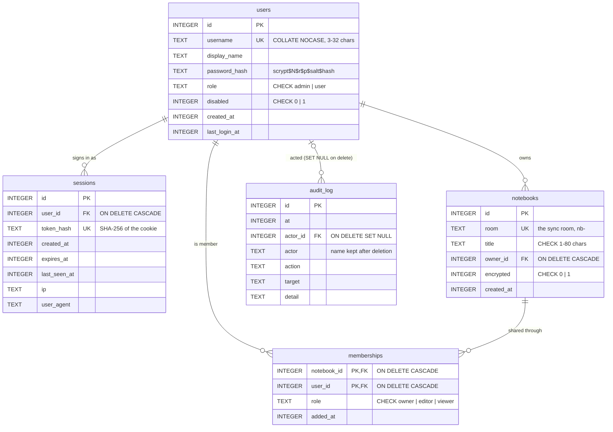

# Accounts, sharing and the admin console

The engine syncs *rooms* between *replicas*. A deployment that people use also
needs to know *who* they are, which notebooks they own, and who else may read
or write each one. `--accounts` adds exactly that, as a relational layer next
to the operation logs rather than inside them.

```bash
RIVULET_ADMIN_PASSWORD=change-me npm run serve -- --demo --accounts
# http://127.0.0.1:8787/            notebooks (sign in or create an account)
# http://127.0.0.1:8787/admin.html  admin console
```

## Two kinds of storage

| Store | Engine | Holds | Shape |
|---|---|---|---|
| `data/accounts.db` | SQLite (`node:sqlite`) | users, sessions, notebooks, memberships, audit log | relational, normalised, constraints and triggers |
| `data/<room>.sqlite` | SQLite, one file per room | the notebook's CRDT operations | append-only log keyed by `(node, seq)` |

The split is deliberate. Notes are merged by CRDTs and must replicate to every
device, offline included; accounts are authoritative facts that only the
server decides (a password, a role, a membership) and that must never be merged
by "last writer wins". Each kind of data lives in the model that fits it.

## The relational schema



All tables are in third normal form: every non-key column depends on the whole
key and nothing else. The two deliberate exceptions are documented in place:
`audit_log.actor` copies the username so the log still reads correctly after
the account is deleted, and `notebooks.owner_id` duplicates the `owner` row in
`memberships` so that "who owns this" never needs a filtered join.

**What the database enforces**, so that no code path can get it wrong:

| Rule | Mechanism |
|---|---|
| Usernames are unique, ignoring case | `UNIQUE ... COLLATE NOCASE` |
| Roles and flags take only valid values | `CHECK` constraints |
| Deleting a user removes their sessions, memberships and owned notebooks | `FOREIGN KEY ... ON DELETE CASCADE` (with `PRAGMA foreign_keys = ON`) |
| The audit log survives the people in it | `ON DELETE SET NULL` plus the denormalised name |
| Every notebook's owner is a member | trigger `notebook_owner_is_member` (`AFTER INSERT ON notebooks`) |
| There is always an active admin | triggers `keep_an_admin_on_update` and `keep_an_admin_on_delete` (`RAISE(ABORT)`) |
| A multi-step change lands whole or not at all | every write runs in `BEGIN IMMEDIATE ... COMMIT` |

**Indexes** follow the queries: `sessions(user_id)` and `sessions(expires_at)`
for sign-out and purging, `notebooks(owner_id)`, and `memberships(user_id)` for
"my notebooks" (the primary key already serves "who is in this notebook").

**Views** keep reporting queries in SQL rather than in JavaScript:
`user_overview` (each user with notebooks owned and joined, and when they were
last seen) and `notebook_overview` (each notebook with its owner's name and
member count). The counts are correlated subqueries rather than a `GROUP BY`,
so SQLite flattens the view into the query that uses it and every lookup stays
on an index. Views hold no data, so they are dropped and recreated on start
and a changed definition needs no migration.

`EXPLAIN QUERY PLAN` for the queries on the hot path:

```
access check, every sync         SEARCH n USING COVERING INDEX sqlite_autoindex_notebooks_1 (room=?)
                                 SEARCH m USING PRIMARY KEY (notebook_id=? AND user_id=?)
session lookup, every request    SEARCH s USING INDEX sqlite_autoindex_sessions_1 (token_hash=?)
                                 SEARCH u USING INTEGER PRIMARY KEY (rowid=?)
my notebooks                     SEARCH m USING INDEX memberships_by_user (user_id=?)
                                 SEARCH n USING INTEGER PRIMARY KEY (rowid=?)
                                 SEARCH o USING INTEGER PRIMARY KEY (rowid=?)
                                 SEARCH m USING PRIMARY KEY (notebook_id=?)   -- member count
sign-in by username              SEARCH users USING INDEX sqlite_autoindex_users_1 (username=?)
```

With 201 users, a sign-in costs about 45 ms (almost all of it scrypt, by
design) and the per-sync authorisation about 16 µs.

The admin console's **Database** tab prints all of this from `sqlite_schema`,
with row counts, so the schema on a running server can be checked against this
page.

## How a request is authorised

```
browser                         server
   │  POST /api/auth/login         │  scrypt-verify the password
   │ ────────────────────────────▶ │  INSERT INTO sessions (token_hash = sha256(token))
   │  Set-Cookie: rv_session=…     │
   │ ◀──────────────────────────── │
   │  GET /api/me                  │  session → user
   │ ────────────────────────────▶ │  sync token = rvs1.<session id>.<HMAC(secret, id)>
   │ ◀──────────────────────────── │
   │  POST /v1/sync                │  authorize hook:
   │  Authorization: Bearer rvs1…  │   1. HMAC valid?        (no DB access)
   │ ────────────────────────────▶ │   2. session live, user enabled?   (1 indexed lookup)
   │                               │   3. member of this room? viewer writing? (1 indexed lookup)
```

- **Passwords** are hashed with scrypt (N = 2¹⁴, r = 8, p = 1, 16-byte salt,
  32-byte key); the parameters are stored with each hash so they can be raised
  later. An unknown username still costs one hash, so response time does not
  reveal which names exist.
- **Session cookies** are random 256-bit tokens, `HttpOnly`, `SameSite=Lax`,
  and `Secure` over https. Only their SHA-256 is stored, so a copy of the
  database does not contain usable sessions.
- **CSRF**: every request that changes something must be
  `application/json`. A form on another site cannot send that without a CORS
  preflight, which this API never grants.
- **Sync tokens** are checked against the live session on *every* sync, so
  signing out, disabling an account, resetting a password or removing a member
  takes effect on the next request rather than when some token expires.
- **Viewers** may pull and subscribe but not push; the page also makes no edits
  for them, so nothing piles up unsent.
- **Brute force**: sign-in and sign-up share a per-address token bucket
  (10 attempts, then one per 6 seconds).
- Signed room tokens (`rv1.…`, [`src/server/tokens.js`](../src/server/tokens.js))
  still work alongside when `RIVULET_SECRET` is set, so the Android daemon and
  command-line clients use the same server.

## Roles

| | user | admin |
|---|---|---|
| Create notebooks, share them by username (editor or viewer), rename, delete | own notebooks | any notebook |
| Open a notebook | as owner, editor or viewer | any notebook (from the console) |
| Create accounts with a role, change roles, disable, reset passwords, delete | | ✓ |
| Overview, notebooks with sync statistics, audit log, schema | | ✓ |

## API

| Method | Path | Who | Does |
|---|---|---|---|
| POST | `/api/auth/register` | anyone (unless `--no-signup`) | create an account with a first notebook, sign in |
| POST | `/api/auth/login` | anyone | sign in |
| POST | `/api/auth/logout` | signed in | end this session |
| GET | `/api/me` | anyone | the user (or `null`) and a sync token |
| POST | `/api/me/password` | signed in | change password; other sessions end |
| GET / POST | `/api/notebooks` | signed in | list mine / create |
| PATCH / DELETE | `/api/notebooks/:id` | owner, admin | rename / delete (drops the room's log) |
| GET | `/api/notebooks/:id/members` | members | who has access |
| POST | `/api/notebooks/:id/members` | owner, admin | share by username as editor or viewer |
| DELETE | `/api/notebooks/:id/members/:user` | owner, admin, or yourself | unshare, or leave |
| GET | `/api/admin/overview` | admin | counts, sync storage, server health |
| GET / POST | `/api/admin/users` | admin | list / create with any role |
| PATCH / DELETE | `/api/admin/users/:id` | admin | role, disabled, display name, password / delete |
| GET / DELETE | `/api/admin/notebooks[/:id]` | admin | every notebook with sync statistics / delete |
| GET | `/api/admin/audit` | admin | most recent events |
| GET | `/api/admin/schema` | admin | the accounts schema with row counts |

## Deploying

The repository's `render.yaml` deploys the Docker image to Render:

1. Render dashboard → **New** → **Blueprint** → choose this repository.
2. Enter `RIVULET_ADMIN_PASSWORD` and `RIVULET_DEMO_PASSWORD` when asked.
3. The service starts with an `admin` account and a `demo` account whose
   notebook already holds three notes.

Any Docker host works the same way:

```bash
docker build -t rivulet-server .
docker run -p 8787:8787 -v rivulet-data:/data \
  -e RIVULET_FLAGS="--demo --accounts" \
  -e RIVULET_ADMIN_PASSWORD=change-me \
  -e RIVULET_DEMO_USER=demo -e RIVULET_DEMO_PASSWORD=change-me-too \
  rivulet-server
```

Accounts are seeded on every start and existing ones are left alone, so
changing a variable later does not reset a password; use the console for that.
Behind a platform load balancer add `--trust-proxy` so rate limits and the
`Secure` cookie flag see the real client address and scheme.

On Render's free plan the disk is not persistent: `/data` is reset when the
service restarts or redeploys, and the seeded accounts come back with it. Mount
a disk at `/data` to keep everything.

## Tests

`src/server/accounts.test.js` covers the store: hashing, case-insensitive
uniqueness, session expiry and revocation, the last-admin triggers, cascades,
and the sync authoriser following membership changes live.
`src/server/accounts-api.test.js` runs the real HTTP server: sign-up and
sign-in, the JSON-only CSRF rule, members syncing while strangers and viewers
are refused, owner-only changes, and every admin route.
